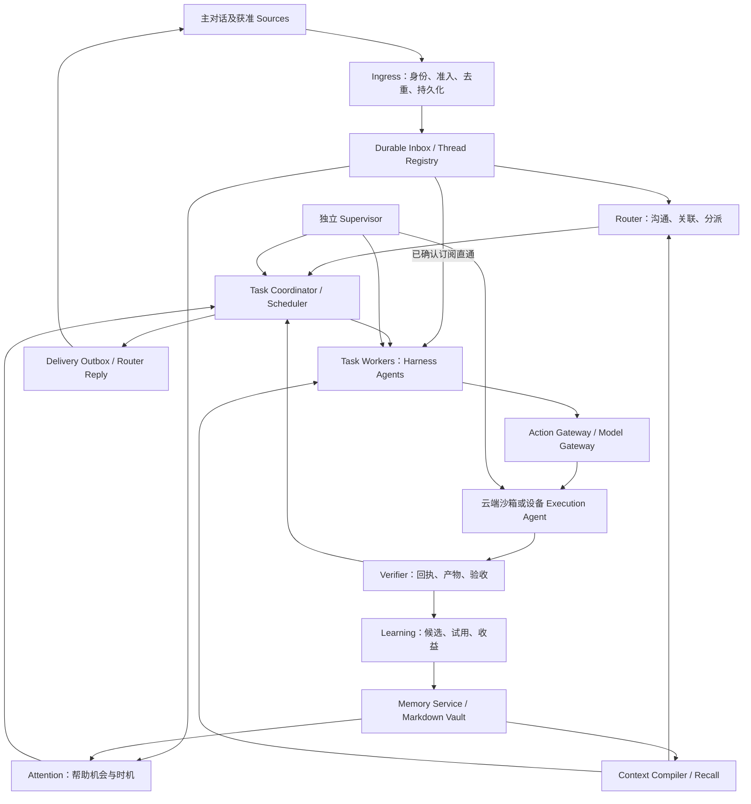

# SA1 完整架构

状态：设计基线；全部能力均需按[验收合同](acceptance.md)实现验证。SA1 描述同一完整产品，不以开发阶段划分功能。UI 布局、视觉、客户端组件和交互原型不在本次设计范围；会话协议和用户控制语义属于后端合同。

## 1. 产品承诺与边界

知微服务一个人的持续工作与生活事务。用户可以从主对话或已连接渠道交代目标，执行期间继续发消息；系统关联上下文、并行推进独立任务、跟进获准事件、提前准备，在必要时请求决定。研究、写作、开发、资料整理和个人事务共用同一任务与授权模型。

默认交付形态是自托管云端实例，一个实例服务一个所有者；同一发行物可部署在本机，也可连接多个执行设备。数据包含 `ownerId` 和 `workspaceId`，用于明确隔离与迁移；SA1 不提供组织成员权限管理、共享团队租户或 SaaS 计费系统。云端不意味着自动上传全部个人设备资料。

完成标准：同一事项跨日、跨来源继续；用户修改要求影响实际行动；不需要用模型查询进度；失败和未知可见；有证据的记忆可以纠正与遗忘；主动帮助高于打扰成本；停止、撤权和恢复不会产生隐蔽的重复动作。

## 2. 总体结构

箭头表示受控端口，不表示允许任意读写。Router、Worker、学习和监督所需模型能力由 Harness 原生 Agent Loop 承载；知微通过插件提供状态机、事件队列、工具和权限，不实现另一套 ReAct Loop。

## 3. 职责与部署单元

| 逻辑组件 | 唯一职责 | 不拥有的能力 |
|---|---|---|
| Ingress / Connector Host | 认证、来源游标、事件正规化、附件隔离 | 从消息正文识别授权身份 |
| Router | 统一交互、任务归属、跨任务协调、最终答复组织 | shell、直接外部写、宣布任务验收成功 |
| Task Coordinator | 持久状态、计划依赖、分配、等待、取消、预算 | 替代 Worker 内部推理与工具选择 |
| Worker Host | 在专用 Harness Profile 中管理 Assignment 的 Agent、输入与事件 | 直接写控制数据库或长期记忆 |
| Action / Model Gateway | 每次执行与模型发送的授权、预算、回执 | 由模型文本扩大 Grant |
| Execution Agent | 在指定环境执行获准 Job，报告真实结果 | 全局认知和其他设备的权限 |
| Verifier | 根据预声明标准判断成果 | 用 Worker 自评独自认证成功 |
| Memory / Learning / Attention | 记忆治理、受评估学习、主动候选 | 自授持续授权或改系统安全规则 |
| Delivery | 对正确受众投递获准内容、去重与回执 | 任意复制内部全局上下文 |
| Supervisor | 基础设施和任务进展监督、有限恢复 | 修改权限、验收标准或任意补丁自修复 |

默认部署 `control-plane`、`worker-host`、`execution-agent` 三类进程。前两者由固定 `dsh` 启动器加载各自的知微 Profile/Bundle，使用不同进程与权限；Execution Agent 作为受控设备程序。Connector、Memory、Learning、Attention、Verifier 是知微控制面插件；后台模型推理通过 Worker Host 的专用 Agent 执行，不阻塞控制面。Supervisor 是独立进程，拥有只读状态和有限恢复端口。

插件化负责能力组合、依赖和清理，不重新定义业务真源。Policy、Task Ledger、Memory 资格和 EffectFence 是部署必需服务，模型无权卸载、替换或改其配置。未就绪或组合不合格时，知微 readiness gate 拒绝公开 API/模型/工具接纳，不依赖上游对非必需插件失败的告警即继续行为。

## 4. 逻辑 Router 与作用域

每个所有者只有一个逻辑 Router 协调权威和有序 mailbox。主对话对用户表现为连续实体，底层 Session 可以压缩、轮换或重建。

长期全局上下文不能直接复用到所有外部渠道。Router 的模型上下文按 `audience + workspace + policyEpoch` 分区：所有者私有主对话、外部邮件串、群话题分别获得自己的合格材料。跨分区联系由受控引用图和明确的数据共享许可建立，不复制另一个分区的完整对话。

同一推理批次只合并同一分区事件。逻辑 Router 可以包含多个隔离 Session，但任务创建/控制仍由同一持久协调服务串行提交。只有内容在当前受众允许范围内，才可进入答复生成和 Delivery；依赖事后文本分类无法可靠补救已混入模型上下文的私密材料。

## 5. 五条协作路径

1. **直接请求**：用户消息 → durable receipt → Router 关联/新建 Task → Worker → Verifier → 可检查结果。
2. **后续事件**：已订阅 Thread → 授权与版本检查 → 对应 Task Inbox；只有新事项/歧义才回 Router。
3. **主动帮助**：获准变化/承诺 → 候选 → 静默、准备、通知或已有授权内执行。
4. **主动学习**：目标缺口/结果/纠正 → 调查或归纳 → 证据 → 记忆候选/做法试用 → 有条件发布。
5. **恢复**：故障/停滞 → Supervisor 分类 → 查询已有结果/重建会话/等待设备/停止，保留未知效果。

## 6. 技术选择

| 层 | SA1 决策 |
|---|---|
| 应用 | TypeScript strict、Node.js 24 系列；部署制品固定精确版本与摘要 |
| 应用宿主 / Agent Runtime | DeepSeek Harness 0.2.2-alpha.2；Cordis 组合与原生 Agent Loop，调用公开插件侧 Agent API |
| 服务通信 | HTTPS 命令 + SSE 事实订阅；内部受认证的流式 RPC |
| 控制存储 | PostgreSQL 17：事务状态、租约、预算、Inbox/Outbox、记忆提交目录 |
| 内容 | 私有 S3 对象存储；本地部署可用满足同一合同的文件对象适配器 |
| 记忆格式 | UTF-8 Markdown + 受限 YAML front matter，精确版本与证据引用 |
| 搜索 | 可重建全文与向量投影，均受目录资格过滤；不作为授权或事实真源 |
| 执行 | 每个 Assignment 独立沙箱/工作目录；设备通过出站认证连接接入 |
| 调度 | PostgreSQL 持久作业与行租约；通知仅唤醒，数据库记录决定实际工作 |

首选系统不依赖额外 Kafka、Redis、图数据库或插件市场。全文索引可使用 PostgreSQL 的派生搜索表，中文需显式分词并验收；向量索引使用受支持的 pgvector 扩展，无法提供时返回明确能力缺失，不伪装为同等检索。正文不存入事实表；搜索投影可以删除重建。详见[存储](memory.md)。

## 7. 模块边界

目标代码组织是 `apps/execution-agent`、`apps/supervisor`，以及 `packages/contracts`、`domain`、`harness-bridge`、`bundle-control-plane`、`bundle-worker`、`plugins`、`storage`、`connectors`。控制面与 Worker Host 的应用入口由两个 Bundle 提供，仍使用 `dsh --profile <name>` 启动。这是未来实现的责任映射，本次不创建空实现。

- `contracts` 不依赖 Runtime；`domain` 不执行 I/O；应用组合端口。
- Harness/Cordis 类型只出现在 `harness-bridge`、Bundle 与插件入口；领域、控制库和 API DTO 保持知微自有合同。
- Connector 的读端与写端分开；同一个帐号连接不意味着所有读写都获准。
- 权限、完成判定、scope 和版本是核心语义，不能被插件或 Prompt 覆盖。
- 配置有版本；新 Session 固定模型/工具/Runtime 配置，权限收紧立即生效。配置扩大需要新的授权。

## 8. 不承诺的能力

不承诺模型永不犯错、无限上下文、普遍 exactly-once、已经发出的数据可收回、离线设备能执行在线命令。保留明确的 unknown、unavailable、needs-reconciliation 状态。完整设计并不等于这些合同已经验证；验收证据与源码调查分别登记。
